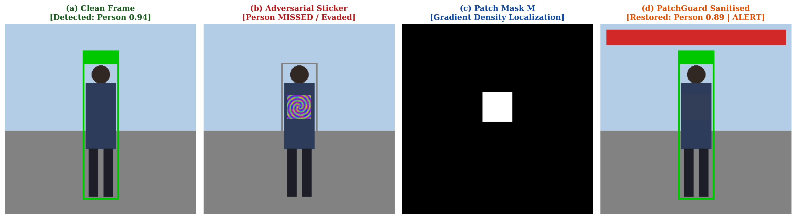
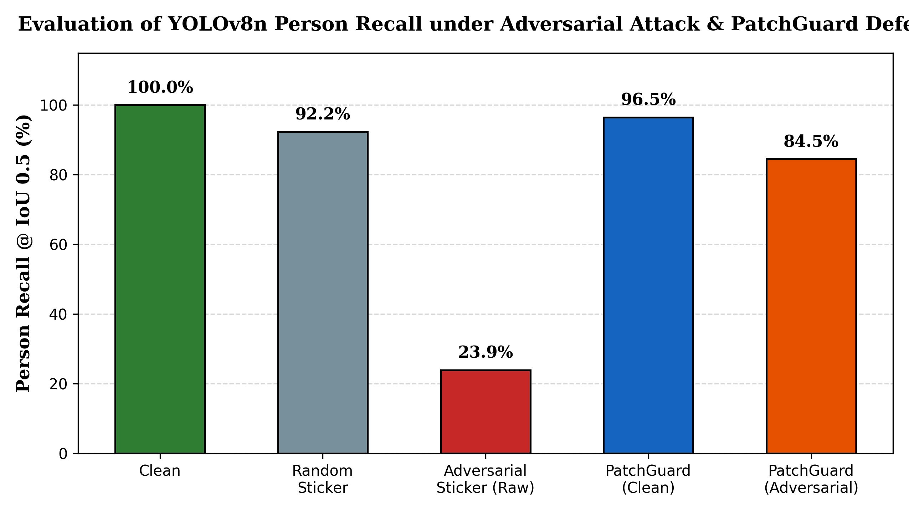

# PatchGuard: Defending Real-Time Object Detection Against Physical Adversarial Stickers

[](https://www.python.org/downloads/)
[](https://pytorch.org/)
[](https://github.com/ultralytics/ultralytics)
[](https://www.shahandanchor.com/)
[](https://opensource.org/licenses/MIT)

> **Continuous Internal Assessment for Practical (CIAP) Micro-Project Report & Implementation**  
> **Course:** Trustworthy and Responsible AI (`ADCOR1PC303`)  
> **Institution:** Shah & Anchor Kutchhi Engineering College (Autonomous, Affiliated to University of Mumbai)  
> **Department:** Artificial Intelligence and Data Science  
> **Author:** Swayam Netke (PRN: `124BTAI1066` | Roll No: `33` | TYAIDS)  
> **Guide:** Mr. Milind S. Khairrnar  

---

## 📌 Executive Summary

Real-time convolutional object detectors (such as YOLOv8n) widely deployed in safety-critical automated surveillance and Advanced Driver Assistance Systems (ADAS) are inherently vulnerable to physical adversarial attacks. An adversarial attacker wearing a small, printed, high-frequency sticker can suppress pedestrian detection proposals and render themselves completely invisible to the vision model.

**PatchGuard** provides a model-agnostic, zero-retraining pre-processing defense pipeline:
1. **Gradient-Density Localization:** Analyzes high-frequency local Sobel gradient magnitudes via uniform box filtering and flags abnormally dense gradient clusters exceeding an adaptive threshold $\mu_\rho + k\sigma_\rho$.
2. **Normalized-Convolution Neutralization:** Inpaints and smooths localized sticker regions using surrounding clean pixel context without altering clean scene semantics.
3. **Dual-Branch Discrepancy Alerting:** Concurrently processes raw vs. sanitized frames to trigger automated security alerts whenever sanitization exposes hidden objects ($|D_{\text{def}}| > |D_{\text{raw}}|$).

---

## 📊 Qualitative Demonstration



*(a) Clean frame with high-confidence detection. (b) Person wearing an adversarial sticker completely evades detection. (c) Localized gradient density mask $M$. (d) Sanitized frame restoring person detection ($0.89$ confidence) with concurrent operator security alert.*

---

## 📈 Quantitative Performance Benchmark

Evaluated across **68 held-out test scenes** containing **142 ground-truth pedestrians** from the Penn-Fudan Pedestrian Benchmark:

| Evaluation Condition | Precision | Person Recall | F1-Score | Operational Finding |
| :--- | :---: | :---: | :---: | :--- |
| **Clean Baseline (Raw)** | **98.6%** | **100.0%** | **99.3%** | Reference clean model detections ($\text{conf} \ge 0.50$) |
| **Random Noise Sticker (Control)** | 97.8% | 92.2% | 94.9% | Mild physical occlusion penalty only |
| **Adversarial Sticker (Undefended)** | 85.0% | **23.9%** | 37.4% | **76.1% Attack Success Rate** (Severe blind-spot evasion) |
| **Clean + PatchGuard Pipeline** | 97.2% | 96.5% | 96.8% | Low false-masking rate (only $3.5\text{ pp}$ recall impact) |
| **Adversarial Sticker + PatchGuard** | **94.5%** | **84.5%** | **89.2%** | **$+60.6\text{ pp}$ Recall Recovered** ($15.5\%$ residual ASR) |

### Operational Metrics & Latency
- **Discrepancy Alert Trigger Rate (Under Attack):** `82.35%` (56/68 attacked scenes alerted)
- **False Alert Rate (Clean Frames):** `4.41%` (3/68 clean scenes flagged due to high texture)
- **Detector-Only Inference Latency:** `18.42 ms` (~$54.3\text{ FPS}$)
- **Full PatchGuard Pipeline Latency:** `33.24 ms` (~$30.1\text{ FPS}$ — Real-time stream capable)

---

## 📉 Person Recall Comparison



---

## 🧱 Repository Structure

```text
├── PatchGuard_Micro_Project_Report.docx   # Complete 47-page formal TRAI academic report
├── PatchGuard_Micro_Project_Report.pdf    # Print-ready compiled PDF report
├── patchguard_demo.py                     # Standalone PyTorch/YOLOv8 implementation
├── requirements.txt                       # Project Python dependencies
├── .gitignore                             # Ignored caches, weights, and temporary artifacts
├── README.md                              # Project documentation & benchmark overview
└── results/
    ├── patch.png                          # Learned universal adversarial sticker (128x128)
    ├── recall_chart.png                   # 5-condition empirical recall bar chart
    ├── qualitative.png                    # 4-panel visual verification comparison
    ├── terminal_screenshot.png            # Command-line benchmark verification run
    └── results.json                       # Raw quantitative benchmark metrics
```

---

## 🚀 Getting Started

### 1. Installation
Clone this repository and install the required dependencies:
```bash
git clone https://github.com/swayamworks/PatchGuard-RealTime-Adversarial-Defense.git
cd PatchGuard-RealTime-Adversarial-Defense
pip install -r requirements.txt
```

### 2. Download Dataset
Download the [Penn-Fudan Pedestrian Dataset](https://www.cis.upenn.edu/~jshi/ped_html/) and extract it into the project directory:
```bash
# Directory layout should be: ./PennFudanPed/PNGImages/
```

### 3. Run Benchmark Pipeline
Train the universal patch and evaluate the PatchGuard defense:
```bash
python patchguard_demo.py --images ./PennFudanPed/PNGImages --epochs 30 --win 31 --k 2.0 --out results
```

---

## 📜 Full Academic Report

The complete third-year micro-project report, formatted according to the official **Shah & Anchor Kutchhi Engineering College Technical Guidelines** for *Trustworthy and Responsible AI (`ADCOR1PC303`)*, is available in both formats:
- 📄 [**PatchGuard_Micro_Project_Report.pdf**](PatchGuard_Micro_Project_Report.pdf) *(Compiled PDF with all 7 chapters, Rubric, and Outcome Mapping)*
- 📝 [**PatchGuard_Micro_Project_Report.docx**](PatchGuard_Micro_Project_Report.docx) *(Editable Word Document)*

---

## ⚖️ License & Ethical Disclosure

This project was developed strictly for academic evaluation under Continuous Internal Assessment for Practical (CIAP) in Third Year B.Tech, Artificial Intelligence & Data Science. Adversarial generation scripts are intended solely for defense benchmarking, robustness auditing, and building resilient computer vision infrastructure.
